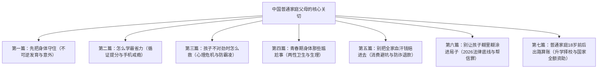

# 《青少年高性价比成长指南》：基于家长视角的分类重构方案

## 一、为什么原先的分类不像“家长在看书”？

原先的分类方式（如“生命安全与黄金急救窗口”、“视力口腔脊柱与睡眠管理”、“青春期发育与男女生理专章”），本质上是**医学与行政法条的学院派分类法**。

**现实中中国普通家庭父母翻开这本书时，心里想的从来不是“我今天来学学医学急救与治安法规”，而是：**
1. *“孩子近视又涨了 100 度，后槽牙烂了，怎么不花冤枉钱治好？”*
2. *“天天抱着手机拖拉到半夜，熬夜又长不高，学习方法到底哪里错了？”*
3. *“在学校有没有被人孤立欺负？突然不想去上学头痛呕吐到底怎么回事？”*
4. *“青春期跟吃了火药一样不跟我们说话，有些身体隐私话做爸妈的怎么开口？”*
5. *“外面的培训班、志愿卡、视力仪全是陷阱，怎么守住家庭血汗钱？”*
6. *“初中高中混社会打架、网上买卖账号，怎么保证孩子不进派出所留案底？”*
7. *“普通家庭没钱没背景，孩子中考高考后到底怎么规划出路和国家资助？”*

---

## 二、新分类重构：完全对齐家长心智模型的 7 大终极板块

参照《HowToLiveBetter》**“直接用老百姓大白话、直击利害关系、算账式防踩坑”**的精髓，把全书重构为**家长一眼就能对号入座的 7 大核心篇章**：

---

## 三、各篇章详细说明与解决的家长焦虑

### 第一篇：先把身体守住 —— 近视、烂牙、骨骼与突发意外怎么防
> **家长的焦虑**：孩子眼轴拉长不可逆、恒牙烂掉要花大几万、个子长不高、体育运动骨折崴脚。
- **涵盖内容**：
  - 白天户外 2 小时防近视、0.01% 阿托品适应症、OK 镜眼内炎避坑；
  - 六龄齿窝沟封闭、深龋浅龋补牙算账、下颌阻生智齿预防；
  - 骨龄闭合前脊柱侧弯亚当斯自查、增高针骗局、深度睡眠生长激素分泌；
  - 溺水不手拉手、海姆立克急救、烫伤冲冷水 20 分钟、运动裆部撞伤冷敷、流鼻血前倾按压、生锈钉扎伤破伤风规范。

### 第二篇：怎么学最省力 —— 认知科学提分法与手机注意力夺回
> **家长的焦虑**：每天磨蹭到凌晨、周末狂补课成绩没起色、做作业离不开手机、考前焦虑失眠。
- **涵盖内容**：
  - 用“主动回忆自测”打破拿着荧光笔划书的熟练度幻觉；
  - 艾宾浩斯 1-3-7 天间隔复习代替考前熬夜突击；
  - 数理化“穿插刷题”培养题型临场识别力；
  - 手机物理隔离（放在另一个房间）消除大脑工作记忆流失；
  - 考前 10 分钟草稿纸书写清空紧张心慌；
  - 破除“女孩初中高中学不好理科”伪科学刻板印象。

### 第三篇：孩子不对劲时怎么救 —— 心理自救、厌学躯体化与校园防霸凌
> **家长的焦虑**：孩子天天喊肚子疼不想上学、身上有划痕、被同学孤立威胁、两代人沟通冷战。
- **涵盖内容**：
  - 12356 全国心理援助热线与 12355 青少年权益热线实操；
  - 厌学、晨起干呕头晕是“躯体化障碍”，凭公立三甲证明依法申请休学保留学籍 1 年；
  - 坚决不去社会上打骂电击的“全封闭戒网瘾黑特训营”；
  - 2026 新《治安管理处罚法》学生欺凌追责与满 14 周岁拘留线；
  - 遭遇霸凌如何第一步拍照留存伤痕、衣物物证与聊天录屏，拒绝和稀泥。

### 第四篇：青春期身体那些尴尬事 —— 男孩女孩两性生理与卫生常识
> **家长的焦虑**：孩子生理发育变化自己不好意思问、家长不知道怎么开口、怕孩子染上毛病。
- **涵盖内容**：
  - 13~14 岁国家免费两剂次二价 HPV 疫苗算账；
  - 女孩原发性痛经首选布洛芬（不耐药不成瘾的药理事实）；
  - 经期卫生巾 2~4 小时更换防细菌逆行感染、私处只用清水洗；
  - 男生生理性包皮过长与病理性包茎区分，拒信莆田系激光切除；
  - 男生遗精晨勃生理脱敏与内裤卫生；
  - 青春痘（痤疮）外用阿达帕林过氧苯甲酰，严禁挤危险三角区防脑膜炎。

### 第五篇：别把全家血汗钱赔进去 —— 针对家长的消费避坑与防诈退款
> **家长的焦虑**：动辄几千上万的护眼仪/志愿卡、孩子偷拿手机打赏游戏充值、AI 冒充孩子借钱。
- **涵盖内容**：
  - 卫健委红头文件打假“治愈近视、降度数”护眼仪与中药眼贴；
  - 拒买天价高考志愿填报卡，用好教育部“阳光高考”国家免费系统；
  - 手机彻底关闭微信/支付宝“免密支付”与“自动扣款”；
  - 依据《民法典》对未成年人巨额误充值、打赏提起法定全额退款；
  - 全家人约定“防诈暗号”防范利用 AI 换脸拟声冒充孩子出事要钱；
  - 手机 SIM 卡设 PIN 码，防手机丢失后被破解验证码转空存款。

### 第六篇：别让孩子糊里糊涂进局子 —— 2026 未成年人法律红线与底线
> **家长的焦虑**：孩子讲所谓哥们义气惹大事、网上买卖账号卡片被警察找上门、留下终身案底。
- **涵盖内容**：
  - 12、14、16 周岁刑事责任年龄红线（未成年人绝对不是免罪金牌）；
  - 严禁借出身份证、银行卡、电话卡（触犯“帮信罪”面临 5 年金融惩戒）；
  - 警惕果味“上头电子烟”（含依托咪酯按毒品犯罪论处）；
  - 拒当约架“站场撑场面”的共犯；
  - 网上“开盒挂人、人肉搜索”直接触犯侵犯公民个人信息罪；
  - 了解未成年人轻罪犯罪记录封存制度（保障合法复学与就业）。

### 第七篇：普通家庭18岁前后出路算账 —— 升学择校、防套路与国家全额资助
> **家长的焦虑**：中考分流没上普高怎么办？大学学费交不起怎么办？高中毕业打工被黑中介骗。
- **涵盖内容**：
  - 中等职业学校（中专/技校）全免学费政策与普通高中贫困助学金；
  - 大学国家生源地信用助学贷款（每年最高 20000 元，在校期间国家全额贴息）；
  - 3+4 中本贯通（中职直升本科）与公费师范生/定向医学生（免学费发生活费包编制）；
  - 男生满 18 岁当年兵役登记与入伍两年学费代偿、考研加分红利；
  - 高中毕业兼职防“医美贷”、防扣押身份证与高额违约金套路。

---

## 四、方案对比（为什么 7 大板块更优？）

| 维度 | 原 10 分类（学科条块法） | 新 7 大篇章（家长心智法） |
| :--- | :--- | :--- |
| **视角** | 医学/法学/教育学学者视角的条块分割 | **以家长和孩子面对的具体难题为入口** |
| **条理** | 10 个分类存在重叠（如急救与外形、网诈与法律） | **合并同类项，归纳为 7 个明确的家庭护航战场** |
| **查阅体验** | 找问题要在“急救”和“生理”之间来回翻 | **身体篇看病、学习篇提分、危机篇保命、钱包篇防坑、出路篇算账，一目了然** |
| **可读性** | 偏官方与严肃术语 | **直接打中普通家庭痛点，用家长大白话组织目录** |
